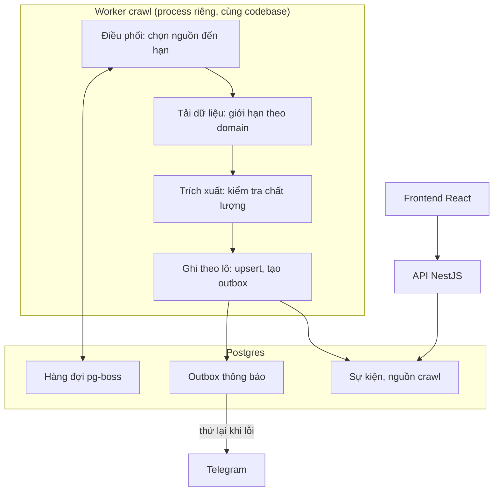

# Event Hub: Kế hoạch tái cấu trúc code, hiệu năng và tốc độ

Cập nhật: 05/11/2026

## Tóm tắt

Giữ monolith NestJS, Postgres và React; viết lại pipeline crawl và API dashboard, vì đây là hai nơi gây sai dữ liệu và chậm nhất. Không cần microservice, Kafka, Redis hay Kubernetes ở quy mô hiện tại. Tổng thời gian ước tính khoảng 6–8 tuần cho một người.

Thứ tự ưu tiên: dữ liệu đúng, rồi crawl nhanh, rồi API nhanh, cuối cùng là dọn frontend.

Cơ sở đánh giá: đọc code backend chính và `App.jsx`, chạy type check và test ngày 05/11/2026. Type check pass, test duy nhất đang fail. Chưa đo trên hệ thống thật; `ClassifierService` và phần lớn view frontend chưa được đọc kỹ, nên các con số trong tài liệu là ước tính hoặc mục tiêu.

## Giữ, bỏ, viết lại

Các quyết định dưới đây sắp theo tác động, phần cần viết lại đứng trước.

| Thành phần | Quyết định | Lý do |
| --- | --- | --- |
| `CrawlerService` | Viết lại | Một class vừa điều phối, chọn engine, dedupe, lưu DB và gửi Telegram; truy vấn DB theo từng item |
| `getDashboardData` | Viết lại | Tải tới 5.000 event rồi lọc trong bộ nhớ; `limit` gần như vô nghĩa |
| `GenericHtmlEngine` | Viết lại | Selector chung dễ lấy nhầm khối, thay bằng cấu hình theo từng web và crawl hai bước |
| Luồng thông báo Telegram | Viết lại | Gửi lỗi vẫn gán `notifiedAt`, làm mất thông báo |
| Cấu hình nguồn trong JSONB | Viết lại | Chuyển sang bảng `crawl_sources`, bỏ phần parse bị lặp |
| Router tự viết trong `App.jsx` | Viết lại | Thay bằng React Router |
| `Setting.jsx` (556 dòng) | Viết lại | Tách theo tab, dùng chung form và modal |
| `GET /crawlers/run` | Bỏ | Kích hoạt crawl bằng GET là sai ngữ nghĩa và dễ bị gọi nhầm |
| `crawlAllSources`, `crawlSource`, `crawlSourceById` | Bỏ | Chỉ gọi lại hàm khác |
| Fallback `15p` trên màn hình crawler | Bỏ | Đã thống nhất mặc định `6h` |
| Bộ lọc tiêu đề trong `EventsService` | Bỏ | Chuyển sang lúc ghi, quy tắc lưu trong settings |
| Logo và Page ID hardcode | Bỏ | Chuyển vào `crawl_sources` |
| Handler giữ process sống sau `uncaughtException` | Bỏ | Ghi log rồi thoát để container khởi động lại |
| `synchronize` tự động | Bỏ | Chỉ đổi schema bằng migration |
| `tsconfig.build.tsbuildinfo` trong git | Bỏ | Là file sinh ra khi build |
| Test "Hello World" đang fail | Bỏ | Không kiểm tra hành vi thật |
| `GenericRssEngine` | Sửa | Parser dùng được; chỉ bỏ bước tải ảnh cho mọi item |
| `GenericApiEngine` | Sửa | Sửa giờ theo múi giờ server, đưa cấu hình Sforum ra ngoài |
| `GenericMetaAdsEngine` | Sửa | Dedupe theo `adArchiveID`; đánh giá chuyển sang API chính thức |
| `CrawlerHttpClient` | Sửa | Thêm giới hạn theo domain và trả lỗi rõ ràng |
| Module NestJS, auth JWT, bcrypt, `ValidationPipe` | Giữ | Thiết kế đúng, chỉ siết thêm cấu hình |
| Helper ngày, URL, nhiễu | Giữ | Hàm thuần, dễ test; bổ sung test |
| Postgres, Docker | Giữ | Đủ cho quy mô này; thêm cấu hình production |

## Kiến trúc đích

Hệ thống vẫn là một codebase và một database, nhưng crawl chạy thành process riêng để không ảnh hưởng API.



Hàng đợi và outbox nằm trong Postgres nên không cần thêm dịch vụ. Worker chết giữa chừng thì job được chạy lại, thông báo chưa gửi vẫn còn trong outbox.

```text
event_hub_be/src/
  main.ts                  # khởi động API
  worker.ts                # khởi động worker
  crawlers/
    orchestrator/          # lịch, chọn nguồn đến hạn, hàng đợi
    pipeline/              # tải, trích xuất, kiểm tra
    engines/               # RSS, API, HTML, Meta Ads
    persistence/           # upsert theo lô
    sources/               # bảng crawl_sources và cấu hình từng web
  notifications/           # outbox, Telegram
  events/                  # truy vấn, phân quyền, API
  settings/  users/  auth/
  migrations/
```

## Tái cấu trúc code

Mục tiêu là mỗi class chỉ làm một việc, để thêm nguồn mới không phải sửa code điều phối.

### Backend

- **Tách `CrawlerService`:** `CrawlOrchestrator` chọn nguồn đến hạn, `CrawlPipeline` xử lý một nguồn, `EventUpsertService` ghi DB, `NotificationService` gửi thông báo.
- **Chuẩn hóa engine:** mọi engine cùng interface `CrawlEngine` với `supports()` và `fetch()`. Chọn engine theo `type` của nguồn, không dò bằng `url.includes(...)`.
- **Kết quả fetch rõ ràng:** trả `ok`, `blocked`, `failed` hay `empty` thay cho `null` hoặc `[]`, để nguồn bị chặn không còn báo `success`.
- **Ranh giới module:** chỉ `SettingsService` đọc bảng `settings`. `TelegramService` chuyển vào module riêng.
- **Tách `EventsService`:** phần truy vấn, phân quyền theo phòng ban và định dạng dữ liệu trả về thành các class riêng. Thiếu user thì từ chối thay vì cho xem hết.
- **Kiểu dữ liệu:** thay `Record<string, unknown>` và các ép kiểu bằng DTO có validate. Kiểm tra biến môi trường lúc khởi động.
- **Log:** thay `console.*` và các khối `catch {}` rỗng bằng log JSON có `runId` và `sourceId`.

### Frontend

- **Router:** React Router thay `VIEW_PATHS` và `pushState`, phân quyền bằng route guard.
- **Gọi API:** TanStack Query thay việc tự quản lý loading và cache.
- **Component:** tách `Setting.jsx`, `Reports.jsx`, `MediaLibrary.jsx`, `Month.jsx` và `OverView.jsx` thành phần nhỏ hơn. Phạm vi cụ thể sẽ chốt sau khi đọc kỹ các view này.
- **Trạng thái giao diện:** thống nhất loading, rỗng và lỗi, thêm Error Boundary.
- **Phiên đăng nhập:** bỏ `event-hub-auth` và token trong `localStorage`, chuyển sang access token ngắn hạn kèm refresh token trong cookie httpOnly.

## Độ chính xác crawl

Làm phần này trước khi tăng tốc, vì crawl nhanh mà sai chỉ tạo dữ liệu sai nhanh hơn. Không crawler nào đúng 100%, nên hệ thống cần ngưỡng đo được và cảnh báo khi xuống dưới ngưỡng.

| Vấn đề hiện tại | Cách sửa |
| --- | --- |
| Không tìm được ngày thì dùng ngày crawl | Đánh dấu `dateUnknown`, không tự gán ngày |
| Selector chung lấy nhầm khối, tiêu đề hoặc link | Cấu hình selector và mẫu URL theo từng web |
| Regex Next.js bắt nhầm menu, danh mục | Đọc JSON có cấu trúc, chỉ nhận URL đúng mẫu bài viết |
| Trang danh sách bị coi là một bài | Chỉ dùng metadata khi URL đúng là trang bài viết |
| Giờ Sforum phụ thuộc múi giờ server | Định dạng cố định theo `Asia/Ho_Chi_Minh` |
| Ảnh lấy `src` trước `data-src` | Ưu tiên `data-src`, loại ảnh placeholder |
| Quảng cáo Meta cùng landing page ghi đè nhau | Thêm `externalId` từ `adArchiveID` |
| Web bị chặn hoặc cần render JS | Báo đúng trạng thái; chỉ dùng headless khi không còn cách khác |

### Quy trình mới

1. **Khảo sát từng web:** chọn cách lấy theo thứ tự API hoặc RSS, dữ liệu nhúng, rồi HTML. Rà `robots.txt` và điều khoản sử dụng.
2. **Tìm bài mới:** trang danh sách chỉ dùng để lấy link.
3. **Lấy chi tiết:** chỉ tải trang của bài mới; lấy tiêu đề, ảnh, ngày đăng từ JSON-LD và Open Graph trước.
4. **Kiểm tra trước khi lưu:** tiêu đề hợp lệ, URL đúng mẫu và cùng domain nguồn.
5. **Xử lý bài không chắc chắn:** đưa vào hàng chờ duyệt, chưa lên dashboard và chưa gửi Telegram.

### Mục tiêu

Các ngưỡng này là đề xuất, sẽ chỉnh sau khi có baseline. Mỗi web có 20–30 bài kiểm tra bằng tay, chạy tự động trong test.

| Chỉ số | Mục tiêu |
| --- | --- |
| Bài lấy về đúng là bài viết thật | ≥ 95% |
| Không bỏ sót bài trong bộ mẫu | ≥ 95% |
| Tiêu đề và URL đúng | ≥ 99% |
| Ngày đăng đúng, trong số bài có ngày | ≥ 98% |
| Phân loại đúng loại sự kiện | ≥ 90% |

Khi chạy thật, hệ thống cảnh báo nếu một nguồn đột ngột không có bài mới, tỷ lệ thiếu ngày tăng cao, hoặc bị chặn.

## Tốc độ crawl

Lãng phí lớn nhất là lặp lại việc đã làm, nên cần bỏ request thừa trước rồi mới chạy song song. Mức cải thiện sẽ được chốt sau khi đo baseline.

| Điểm nghẽn | Cách sửa | Tác động dự kiến |
| --- | --- | --- |
| Mỗi lần crawl tải lại trang của mọi item RSS thiếu ảnh | Chỉ tải cho bài mới, cộng tối đa 10 bài cũ mỗi lần | Lớn nhất |
| Mọi nguồn chạy mỗi 15 phút, bỏ qua `interval` | Cron chỉ kiểm tra, crawl nguồn đến hạn; mặc định `6h` | Lớn |
| Chạy tuần tự, nghỉ cố định 2–3 giây mỗi nguồn | Tối đa 4 nguồn và 3 URL mỗi nguồn cùng lúc; mỗi domain cách nhau khoảng 500 ms | Trung bình |
| Mỗi item một `findOne` và một `save` | Tải event có sẵn một lần, ghi theo lô 100 dòng, bỏ qua dòng không đổi | Trung bình |
| Không chống chạy chồng | Cờ ở giai đoạn đầu, Postgres advisory lock khi lên production | Tránh lỗi |
| Crawl chung process với API | Worker riêng và hàng đợi `pg-boss`, có timeout và retry | API ổn định hơn |

Hai việc để sau khi có số đo: ETag/`If-Modified-Since`, vì có thể bỏ sót bài nếu lần trước lỗi giữa chừng, và tăng mức song song, vì có thể làm tăng lỗi 403/429.

## Hiệu năng API và DB

Chuyển việc lọc và tổng hợp từ bộ nhớ ứng dụng xuống SQL. Mục tiêu đề xuất là dashboard phản hồi dưới 500 ms (p95) với 100.000 event mẫu.

- **Thay `getDashboardData`:** tách thành API thống kê, danh sách theo ngày và danh sách theo nguồn; bỏ phần dữ liệu trả về hai lần.
- **Phân trang:** mọi danh sách dùng cursor và có giới hạn tối đa; `findAll` không còn trả toàn bộ bảng.
- **Chỉ lấy cột cần thiết:** danh sách không trả `rawData`.
- **Phân quyền trong truy vấn:** lọc loại sự kiện bằng SQL, để phòng ban không bị thiếu bài do giới hạn 5.000 dòng.
- **Index:** chọn theo `EXPLAIN ANALYZE` trên truy vấn thật, bỏ index không dùng. `[sourceId]` nhiều khả năng thừa vì đã có index phức hợp bắt đầu bằng cột này.
- **Thời gian:** chuyển sang `timestamptz` và gộp ngày, giờ thành một cột nếu khảo sát dữ liệu cho thấy phù hợp.
- **Ảnh:** lưu về object storage để không phụ thuộc link ngoài có thể hết hạn.
- **Giữ dữ liệu:** xóa `crawler_runs` sau 90 ngày và `rawData` sau 180 ngày, có thể điều chỉnh.
- **Frontend:** tải danh sách theo trang, dùng virtual list cho danh sách dài, cache bằng TanStack Query.

## Bảo mật

Chưa nên đưa hệ thống ra internet trước khi xong nhóm "Trước go-live" và đã thay toàn bộ secret mặc định. Bảng dưới dựa trên việc đọc code, chưa phải kết quả kiểm thử xâm nhập.

| Vấn đề hiện tại | Cách sửa | Khi nào |
| --- | --- | --- |
| Secret dev và mật khẩu admin `123456` nằm trong `docker-compose.yml` | Dùng secret riêng cho từng môi trường, đổi mật khẩu admin, bỏ `INIT_ADMIN_*` sau lần khởi tạo đầu | Trước go-live |
| Postgres mở cổng 5432, mật khẩu `postgres` | Không mở cổng ra ngoài, dùng user riêng ít quyền và mật khẩu mạnh | Trước go-live |
| Login không giới hạn số lần thử | Rate limit theo IP và email, khóa tạm khi sai nhiều lần | Trước go-live |
| CORS mở, `/docs` công khai, không có `helmet` | Chỉ cho domain thật, tắt `/docs` ở production, thêm `helmet` và HTTPS | Trước go-live |
| Staff kích hoạt được crawl, có cả route GET | Xóa route GET, chỉ admin được chạy crawl | Trước go-live |
| `getAllowedTypes` cho xem hết khi thiếu user | Mặc định từ chối, viết test phân quyền cho từng vai trò | Trước go-live |
| URL nguồn crawl có thể trỏ vào mạng nội bộ (SSRF) | Chỉ cho `http(s)`, chặn IP nội bộ và metadata, kiểm tra lại sau mỗi redirect | Trước go-live |
| Nội dung crawl không đáng tin, `url` của event chỉ kiểm tra là chuỗi | Chỉ nhận link `http(s)`, escape HTML khi gửi Telegram, rà các chỗ frontend render nội dung này | Trước go-live |
| JWT lưu trong `localStorage` | Cookie httpOnly + chống CSRF (đã làm 08/11/2026); còn lại: access token ngắn hạn, refresh token, thu hồi phiên | Sau go-live |
| Bot token Telegram lưu dạng rõ trong DB | Mã hóa khi lưu, che khi trả về frontend (đã làm 08/11/2026) | Sau go-live |
| Không có audit log | Ghi lại đăng nhập, quản lý user, đổi settings (đã làm 08/11/2026) | Sau go-live |

Các việc kiểm tra thêm:

- **Lịch sử git:** quét secret bằng `gitleaks`; nếu có secret thật thì thu hồi và đổi ngay.
- **Thư viện và image:** chạy `npm audit` và quét image trong CI, dùng Dependabot hoặc Renovate để cập nhật.
- **Container:** chạy bằng user không phải root, chỉ mở các cổng cần thiết.
- **Sao lưu:** mã hóa bản sao lưu và giới hạn người truy cập.
- **Log:** không ghi token, mật khẩu hay nội dung `Authorization`.
- **Trước go-live công khai:** rà theo OWASP ASVS mức 1. Nếu hệ thống mở ra internet, nên thuê kiểm thử xâm nhập độc lập.

Hoàn thành khi: không còn secret mặc định, test phân quyền và SSRF đều pass, CI không còn lỗi bảo mật mức high trở lên.

## Lộ trình và quyết định cần chốt

Làm theo 4 giai đoạn trong khoảng 8 tuần cho một người, mỗi giai đoạn có thể triển khai độc lập. Thời gian phụ thuộc nhiều vào số web cần hỗ trợ. Có thể go-live nội bộ sau giai đoạn 3, khoảng tuần 4.

| Giai đoạn | Thời gian | Nội dung | Hoàn thành khi |
| --- | --- | --- | --- |
| 1. Nền tảng | Tuần 1 | Migration baseline, sửa lỗi mất dữ liệu, đo baseline | Dựng được DB trống bằng migration; mỗi lỗi dữ liệu có test tái hiện; có số đo baseline |
| 2. Crawl đúng | Tuần 2–3 | Cấu hình từng web, crawl hai bước, bộ mẫu kiểm tra | Bộ mẫu của mọi web đạt ngưỡng đã thống nhất |
| 3. Crawl nhanh | Tuần 4 | Theo interval, chạy song song, ghi DB theo lô, bảo mật nhóm "Trước go-live", triển khai | Crawl lại lần hai không trùng event, số request giảm rõ so với baseline; đạt tiêu chí bảo mật; đã diễn tập rollback và khôi phục DB |
| 4. Kiến trúc đích | Tuần 5–8 | Worker, hàng đợi, outbox, API phân trang và SQL, frontend | Tắt worker giữa chừng không mất job hay thông báo; dashboard đạt mục tiêu 500 ms; E2E pass |

### Tiến độ giai đoạn 1 (07/11/2026)

Đã làm, có test:

- Migration baseline và `AddDateUnknownExternalIdRunMetrics`; tắt `synchronize`, app tự chạy migration khi khởi động (`DB_MIGRATIONS_RUN=false` để tắt). Baseline dùng `IF NOT EXISTS` để chạy được trên DB cũ đã tạo bằng `synchronize`. Đã thử trên Postgres tạm: DB trống, DB cũ có dữ liệu, và schema khớp entity.
- Telegram chỉ gán `notifiedAt` khi gửi thành công; escape HTML nội dung crawl; event `dateUnknown` không được gửi.
- Không tìm được ngày thì `eventDate = null`, `dateUnknown = true`. Ngày giờ không ghi múi giờ được hiểu là giờ Việt Nam; ngày không có giờ thì `eventTime = null`. Event `dateUnknown` không lên dashboard vì truy vấn hiện tại lọc theo `eventDate`.
- Giờ Sforum định dạng theo `Asia/Ho_Chi_Minh`.
- Quảng cáo Meta có `externalId = adArchiveID`, `url` là trang Ad Library của quảng cáo, landing page lưu trong `rawData.landingUrl`.
- Lần chạy crawl có trạng thái `success`, `partial`, `blocked` hoặc `failed`; lưu `requestCount` và `durationMs`, ghi log JSON `crawl_run` để đo baseline.
- Test chạy với `TZ=UTC` để bắt lỗi phụ thuộc múi giờ server.

Chưa làm: đo baseline trên nguồn thật (cần chạy crawl thật).

### Tiến độ bảo mật nhóm "Trước go-live" (07/11/2026)

Đã làm, có test (`src/security.spec.ts`):

- Chỉ admin được chạy crawl; đã xóa `GET /crawlers/run`.
- Giới hạn đăng nhập: 5 lần / 15 phút mỗi email, 20 lần / 15 phút mỗi IP (`@nestjs/throttler`, lưu trong bộ nhớ process).
- `getAllowedTypes` mặc định từ chối khi thiếu user hoặc role lạ.
- Chống SSRF: chỉ `http(s)`, chặn IP nội bộ và metadata, kiểm tra lại sau mỗi chuyển hướng. Chưa chống DNS rebinding.
- `helmet`; CORS theo `CORS_ORIGINS` (mặc định `localhost:5173`); tắt `/docs` khi `NODE_ENV=production`.
- Secret trong `docker-compose.yml` chuyển sang `.env` (mẫu ở `.env.example`); Postgres chỉ mở `127.0.0.1`; app không khởi động nếu thiếu secret, và ở production từ chối secret mặc định.

Còn lại: người dùng tự đổi mật khẩu admin `123456`; đặt `JWT_SECRET`, `DB_PASSWORD` mới khi triển khai; quét lịch sử git bằng `gitleaks`; bật trust proxy khi chạy sau reverse proxy.

### Tiến độ giai đoạn 3 (07/11/2026)

Đã làm, có test:

- Chống chạy chồng: Postgres advisory lock theo nguồn (`CrawlLockService`); lượt trùng trả `skipped`.
- Lượt `running` quá 30 phút chuyển thành `failed` khi khởi động và trước mỗi lượt cron.
- Cron 15 phút chỉ cào nguồn đến hạn theo `interval` (mặc định 6h, tối thiểu 15 phút); "Cào tất cả" vẫn cào ngay.
- Tối đa 4 nguồn song song; giãn cách theo domain trong `CrawlerHttpClient` (mặc định 500 ms, `minRequestIntervalMs` theo nguồn, Thế giới di động 5000 ms). Bỏ nghỉ cố định giữa nguồn và giữa URL.
- Bỏ tải ảnh cho mọi bài RSS; chỉ bài mới thiếu ảnh được tải trang chi tiết, trong giới hạn 10 trang mỗi lần.
- Ghi DB theo lô: một truy vấn tải event của nguồn, insert từng 100 dòng, chỉ update cột thay đổi, `lastSeenAt` cập nhật một lệnh.

Số đo một lần chạy thật (4 nguồn, chỉ link web), là số đo đơn lẻ, chưa phải trung bình:

| | Baseline sáng 07/11 (tuần tự) | Sau giai đoạn 3 (song song) |
| --- | --- | --- |
| Tổng thời gian | khoảng 95 giây (tổng 4 nguồn + nghỉ 2–3 giây giữa nguồn) | 5,7 giây; lượt hai 9,8 giây |
| Request CellphoneS | 11 (cron cũ có lượt 103 do tải ảnh RSS) | 9 |
| Request Hoàng Hà / FPT Shop / Thế giới di động | 4 / 4 / 1 | 4 / 4–6 / 2 |

Cào lại lần hai không tạo event trùng (0 URL trùng). Chưa làm: diễn tập rollback và khôi phục DB (cần môi trường triển khai).

### Tiến độ giai đoạn 4: API dashboard mới (07/11/2026)

- Thêm `GET /dashboard/summary`, `/dashboard/timeseries`, `/dashboard/breakdown?by=type|weekday-hour|week`, `/dashboard/events` (con trỏ, tối đa 100 dòng, không trả `rawData`). API cũ `/events/overview`, `/events/by-date` giữ nguyên cho các trang chưa làm lại.
- Đếm bằng SQL theo giờ Việt Nam. Quyền phòng ban nằm trong điều kiện truy vấn, sửa lỗi thiếu bài khi vượt 5.000 dòng (có test 6.000 bài).
- `eventDate` đang là `timestamp` không múi giờ, giá trị là giờ địa phương của process ghi; SQL cộng độ lệch để ra giờ Việt Nam. Test chạy đúng với `TZ=UTC` và `TZ=Asia/Ho_Chi_Minh`. Chuyển sang `timestamptz` để bỏ độ lệch này là việc riêng.
- Test trên Postgres thật: `src/dashboard/dashboard.service.db.spec.ts`, chạy khi đặt `DASHBOARD_TEST_DB` (DB tạm, test xóa bảng).
- Các trang còn lại (thanh menu, Hằng ngày, Đối thủ, Phòng ban, Lịch tháng, Thư viện ảnh, Cài đặt) chuyển sang `/dashboard/*`; đã gỡ `/events`, `/events/latest`, `/events/overview`, `/events/dashboard`, `/events/by-date`. `GET /dashboard/sources` cho thanh menu; `/dashboard/events` có `includeOwn`, `hasImage`, trả `origin`.
- Migration `TimestampsToTimestamptz`: 13 cột thời gian chuyển sang `timestamptz`, quy đổi từ giờ +7 (Node và Postgres `Asia/Bangkok` đều +7). API dashboard dùng `AT TIME ZONE 'Asia/Ho_Chi_Minh'`, bỏ độ lệch theo múi giờ server. Migration đã chạy trên DB thật ngày 07/11/2026 do dev server tự chạy migration khi phát hiện file mới (chưa thử trên bản sao trước như kế hoạch); đã kiểm tra lại dữ liệu sau khi chạy: mốc thời gian khớp với giá trị ghi nhận trước đó. Bài học: tắt `DB_MIGRATIONS_RUN` hoặc dừng dev server trước khi thêm migration.
- Đo trên DB tạm 100.000 event (một máy dev, 15 lần mỗi truy vấn): p95 cao nhất 295 ms (khung giờ đăng, cả năm); khoảng 30–90 ngày dưới 150 ms. Truy vấn dùng index `eventDate` có sẵn, nên chưa thêm index.

### Lưu ảnh thu nhỏ (08/11/2026)

- Đo ngày 07/11/2026 (script `backups/image-check`, 1.598 link): 98,7% ảnh còn tải được; ảnh web đối thủ không hỏng ảnh nào; 20 ảnh lỗi đều là ảnh quảng cáo Facebook (403). Chưa cần MinIO, nhưng về lâu dài link gốc có rủi ro đối thủ đổi CDN, gỡ bài cũ, chặn hotlink, nên lưu ảnh thu nhỏ khi crawl.
- Module `src/images`: `ImageStoreService` tải ảnh qua `CrawlerHttpClient.fetchBinary` (chống SSRF mỗi bước chuyển hướng, chung hàng đợi giới hạn tốc độ, host ảnh CDN cách nhau ít nhất 1 giây, tối đa 10 MB), thu nhỏ bằng `sharp` (rộng tối đa 600px, WebP chất lượng 75, bỏ EXIF, giới hạn số điểm ảnh), không nhận SVG.
- Lưu vào `IMAGE_STORE_DIR` (mặc định `event_hub_be/storage/images`), tên file `<sha256 của link>.webp`; interface `ImageStorage` để đổi sang MinIO sau này.
- Chạy sau mỗi lần cào một nguồn, không làm chậm hay hỏng lần cào; mỗi lần tối đa 50 bài chưa thử lưu, bài mới trước, nên ảnh bài cũ được lưu dần. Kết quả ghi vào `imageStoreStatus` (`stored`, `failed`, `blocked`, `skipped`). Bài `failed` chưa tự thử lại.
- Nguồn `facebook` mặc định không lưu ảnh (`skipped`) đến khi xem xong điều khoản của Meta; cấu hình nguồn `storeImages` ghi đè mặc định.
- `GET /images/:name` không cần đăng nhập (thẻ `` không gửi token; tên file khó đoán, ảnh vốn công khai). Chuyển sang bắt đăng nhập khi có cookie httpOnly. API `/dashboard/events` trả thêm `imageLocal`; frontend ưu tiên ảnh đã lưu, không có thì dùng link gốc.
- Bỏ proxy wsrv.nl (08/11/2026): frontend không gửi link ảnh ra dịch vụ ngoài; ảnh chưa lưu tải thẳng từ web nguồn với `referrerPolicy="no-referrer"` (đối thủ không thấy địa chỉ Event Hub) và `loading="lazy"`.
- Migration `AddEventImageStore` thêm 3 cột; đã thử trên DB tạm (chạy, so schema với entity, hoàn tác, chạy lại).

### Bảo mật nhóm "Sau go-live" (08/11/2026)

- **Cookie httpOnly:** đăng nhập đặt cookie `eh_session` (HttpOnly, SameSite=Strict, Secure ở production, 1 ngày); token không còn trong nội dung phản hồi hay `localStorage`. `POST /auth/logout` xóa cookie. `JwtStrategy` đọc cookie trước, header Bearer chỉ giữ cho giai đoạn chuyển đổi. Frontend gửi `withCredentials` và kiểm tra phiên bằng `/auth/me` khi mở app.
- **CSRF:** SameSite=Strict, CORS chỉ cho `CORS_ORIGINS` (có `credentials`), và mọi request ghi dữ liệu phải có header `X-Requested-With` (thiếu thì 403). Frontend và backend phải cùng site (cùng domain gốc) để cookie được gửi kèm.
- **Ảnh:** `/images/:name` bắt đăng nhập; `Cross-Origin-Resource-Policy: same-site`, `Cache-Control: private`.
- **Token Telegram:** mã hóa AES-256-GCM bằng `SETTINGS_ENC_KEY` (bắt buộc ở production); `GET /settings` chỉ trả `botTokenSet` và 4 ký tự cuối; ô token để trống thì giữ token cũ. Migration `EncryptTelegramToken` mã hóa token đang lưu. Token cũ từng được trả về trình duyệt nên nên tạo token mới qua BotFather.
- **Nhật ký:** bảng `audit_logs`, interceptor ghi mọi request ghi dữ liệu và đăng nhập (thành công và thất bại): người thao tác, hành động, id đối tượng, tên trường (không có giá trị), IP, kết quả. `GET /audit-logs` (admin), tab "Nhật ký" trong Cài đặt. Request bị chặn trước khi vào controller (CSRF 403, throttle 429, 401 của guard) chưa được ghi.
- **gitleaks (07/11/2026, 38 commit):** 11 kết quả. 10 nằm trong `EVENT_HUB_FE/public/img/viettel.htm`, một trang Facebook lưu khi đang đăng nhập, có khóa phiên; đã xóa file ở commit `15a96d9`, phiên phải được đăng xuất trên Facebook, file vẫn còn trong lịch sử git (repo đang công khai). Kết quả còn lại là badge CircleCI mẫu trong README. Đã ghi fingerprint vào `.gitleaksignore`. Chạy lại: `docker run --rm -v "<repo>:/repo:ro" zricethezav/gitleaks:v8.21.2 git /repo --redact`.
- **Sửa thêm:** lưu cấu hình crawler từ giao diện từng xóa mất `extract`, `api`, `minRequestIntervalMs`, `storeImages` (`normalizeCrawlerTarget` chỉ giữ vài trường); đã sửa và có test.
- **Còn lại:** access token ngắn hạn + refresh token + thu hồi phiên; bỏ hẳn header Bearer; `npm audit` (08/11/2026): sau `npm audit fix` và gỡ `@nestjs/mau` (không dùng), thư viện production của backend và frontend còn 0 lỗ hổng; còn 11 lỗ hổng moderate/low ở backend và 4 ở frontend, đều trong công cụ dev (jest, eslint). Jest giữ ở 30.4.2 vì 30.5 không nạp được `@nestjs/throttler` (vòng lặp require(esm)).

### Rủi ro

| Rủi ro | Cách giảm |
| --- | --- |
| Viết lại làm hỏng tính năng đang chạy | Viết test trước, thay từng phần, không viết lại một lần |
| Đổi schema làm hỏng dữ liệu | Sao lưu, thử migration trên bản sao DB, giữ tương thích ngược |
| Crawl song song bị chặn nhiều hơn | Giới hạn theo domain, theo dõi 403/429, tăng dần |
| Web đối thủ đổi giao diện | Cảnh báo theo nguồn, sửa cấu hình của riêng web đó |
| Nguồn `6h` có dữ liệu chậm hơn hiện tại | Đặt `1h` cho nguồn quan trọng |

### Cần chốt

- [ ] Danh sách web và trang cần theo dõi của từng đối thủ là gì?
- [ ] Bài cần lấy gồm những loại nào: khuyến mãi, sự kiện, ra mắt sản phẩm, hay cả tin công nghệ?
- [ ] Ai duyệt hàng chờ bài không chắc chắn? Đề xuất: admin.
- [ ] Dữ liệu cũ xử lý thế nào? Đề xuất: giữ nguyên, gắn cờ bài nghi sai để duyệt lại.
- [ ] Triển khai ở đâu? Đề xuất: VPS và Docker Compose.
- [ ] Nếu API Meta chính thức không đủ dữ liệu thì sao? Đề xuất: chấp nhận thiếu thay vì dùng endpoint không công khai.
